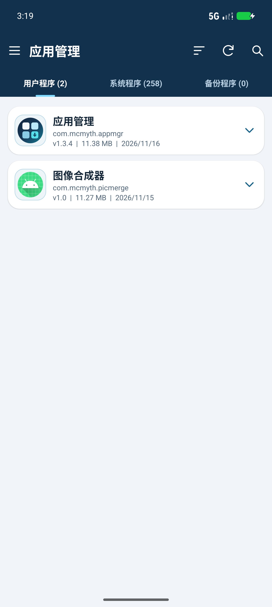
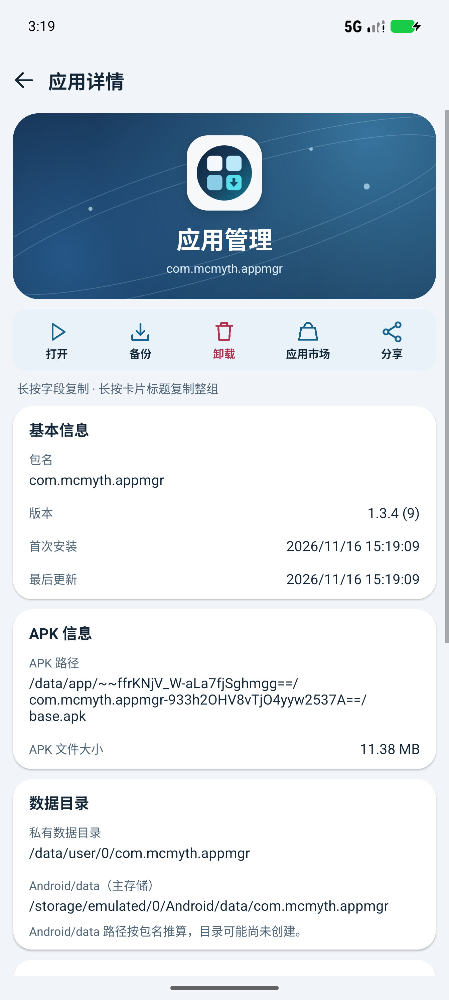
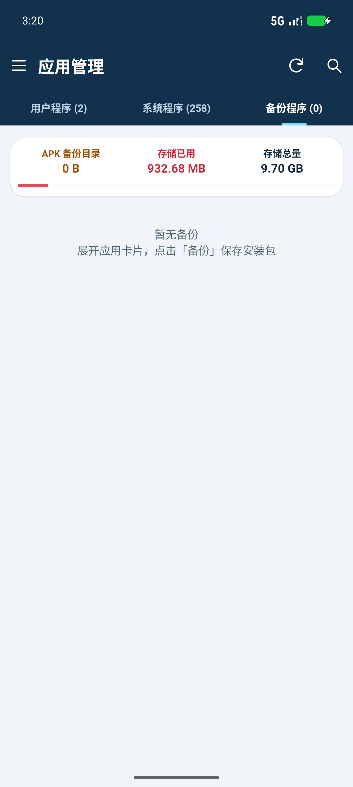

# AppMgr

一款简洁、现代的 Android 应用管理工具，用于查看设备上的应用信息并管理 APK 备份。

## 应用演示

### 应用列表



### 应用详情



### 备份管理



## 主要功能

- 浏览、搜索和排序用户应用与系统应用
- 查看应用版本、SDK、架构、安装位置等详细信息
- 备份、安装、卸载和分享 APK
- 管理普通 APK 与拆分 APK 备份
- 支持自定义备份目录

## 环境要求

- Android 9.0 或更高版本
- Android Studio
- JDK 21
- Android SDK 36.1

## 构建

```shell
./gradlew assembleDebug
```

Windows：

```powershell
.\gradlew.bat assembleDebug
```

构建结果位于 `app/build/outputs/apk/debug/`。

## 许可证

[MIT License](LICENSE)
